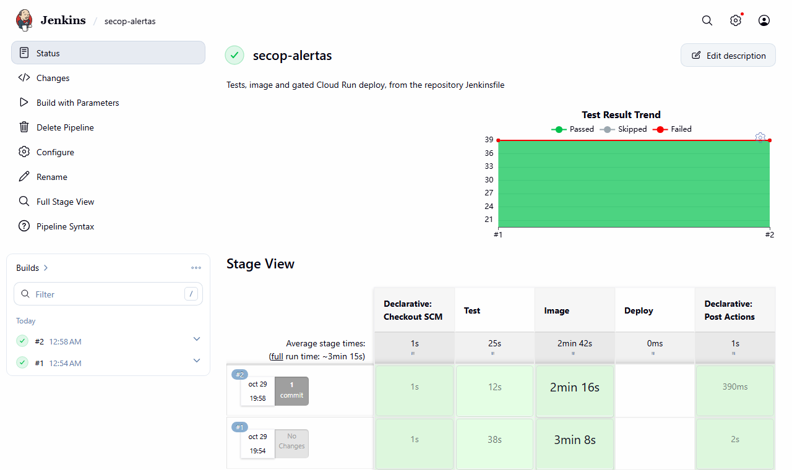

# Jenkins

The repository's `Jenkinsfile` runs the same checks as the GitHub Actions workflow, plus a deploy to Cloud Run
behind a parameter and a manual approval. This folder starts a Jenkins controller configured from files
(plugins in `plugins.txt`, the admin user and the job in `casc.yaml`, Configuration as Code + Job DSL), so it is
ready without clicking through the setup wizard.

```bash
export JENKINS_ADMIN_PASSWORD=<choose one>
docker compose -f ci/jenkins/compose.yaml up -d --build     # http://localhost:8090, user admin
```



## The pipeline

| Stage | What it does |
|---|---|
| Test | Starts a throwaway Postgres 17 for the build; the uv container joins its network namespace, so the database is on `localhost` and nothing is published on the agent. Runs `uv sync --locked`, ruff, the migrations check and pytest, and publishes the JUnit report (39 tests) |
| Image | `docker build`, tagged with the commit, labelled so the cleanup only touches this pipeline's images |
| Deploy | Only with `DEPLOY=true`, and only after someone presses *Deploy*: pushes to Artifact Registry, then updates the Cloud Run job and service to the new image |

Measured on this machine: two builds green, 155 to 235 s, almost all of it the image build.

## Decisions

- **Every tool in a container.** The agent needs Docker and nothing else, so a new agent is ready without
  installing Python, Postgres or the Cloud SDK, and versions are pinned by image tag.
- **Terraform owns the service, the pipeline owns the image.** `deploy/gcp/main.tf` ignores changes to the
  container image, so `terraform apply` never rolls back what the pipeline deployed.
- **The deploy needs a person.** `input` with `beforeInput true`: the stage asks before it takes an executor.
- **No concurrent builds** of the same job: two deploys must not race.
- **Credentials.** The deploy reads a service-account key stored as the Jenkins credential `gcp-deployer`. Workload
  Identity Federation, with Jenkins as an OIDC issuer, would remove the key; worth it once Jenkins deploys more
  than this one service.

## Not done here

The deploy stage has not been run from Jenkins: it needs a key for a deployer account, and the project's policy is to
avoid long-lived keys. The local controller runs builds on itself and as root (to reach Docker Desktop's socket); a
real installation runs builds on agents and gives the jenkins user the socket's group instead.
